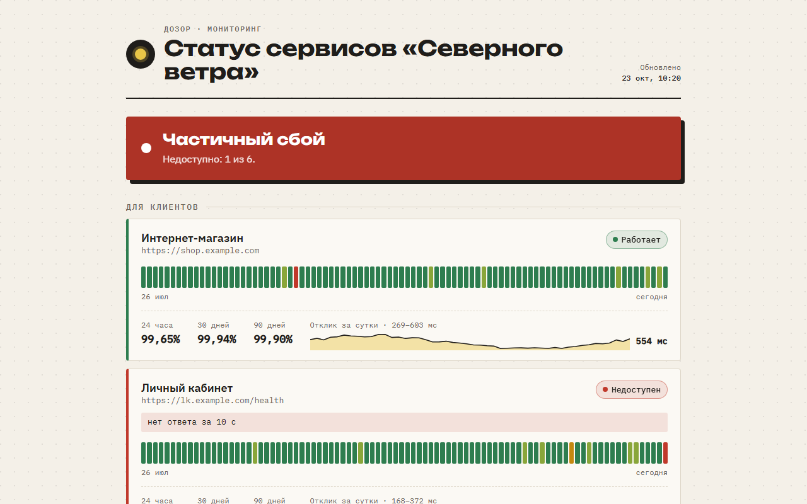

# dozor: мониторинг доступности со страницей статуса

Свой маленький аналог UptimeRobot и Statuspage в одном бинарнике. dozor раз в минуту проверяет сайты, API и порты серверов, открывает инцидент после нескольких сбоев подряд, пишет об этом в Telegram и показывает клиентам публичную страницу статуса с историей за 90 дней. Данные лежат в одном файле SQLite, внешние сервисы и подписки не нужны.


**Демо страницы статуса:** https://whysafe.github.io/dozor/ (статичный снимок на сгенерированных данных)



## Возможности

**Проверки**
- HTTP(S): ожидаемые коды ответа, обязательный текст на странице (`keyword`), порог «медленно» (`slow_ms`).
- Срок действия TLS-сертификата: за `cert_warn_days` дней до конца монитор становится жёлтым, просроченный сертификат считается простоем.
- TCP-порты: базы данных, SMTP, SSH, игровые серверы.
- Понятные причины вместо сырых ошибок: «нет ответа за 10 с», «DNS: не удалось найти …», «код ответа 502, ожидался 200–206», «TLS: сертификат выдан на другое имя».
- Свой интервал и таймаут у каждого монитора, старт проверок разнесён по времени, без залпа запросов.

**Инциденты и уведомления**
- Инцидент открывается после `failure_threshold` сбоев подряд и закрывается после `recovery_threshold` успешных проверок. Одиночный потерянный пакет никого не разбудит.
- Время начала инцидента берётся по первому сбою серии, а не по моменту срабатывания порога.
- Telegram: «Сайт недоступен, причина, с какого времени» и «снова работает, простой 1 ч 35 мин».
- Webhook с JSON для своих интеграций (Slack, n8n, собственный бэкенд).
- После перезапуска открытые инциденты подхватываются из базы: ни дублей, ни потерянных «восстановлено».

**Страница статуса и API**
- Общий баннер («Все системы работают», «Есть замедления», «Частичный сбой»), группы мониторов.
- 90 полосок по дням с подсказкой: процент, число сбоев, средний отклик. На телефоне показываются последние 30 дней.
- Аптайм за 24 часа, 30 и 90 дней, график отклика за сутки, журнал инцидентов за месяц.
- Светлая и тёмная тема по настройке системы, автообновление раз в минуту, работает без JavaScript.
- JSON API: `/api/status`, `/api/monitors/{id}/days?n=90`, `/api/incidents`, а также `/healthz`.
- SVG-бейдж для README: `/badge/{id}.svg` (30 дней) или `?period=90d`.

**Эксплуатация**
- Один статический бинарник, SQLite без CGO (`modernc.org/sqlite`).
- Сырые результаты хранятся `retention_days` дней, дневная статистика остаётся навсегда.
- `dozor check` для cron и CI: проверить всё один раз и выйти с кодом 1 при сбое.
- Строгий разбор конфига: опечатка в ключе — ошибка, все проблемы выводятся одним списком.
- Готовые Dockerfile (distroless, nonroot) и unit-файл systemd с песочницей.

## Стек

Go 1.26 (net/http с маршрутами 1.22+, html/template, embed, log/slog), SQLite через `modernc.org/sqlite`, YAML (`gopkg.in/yaml.v3`), Telegram Bot API, Docker, systemd, GitHub Actions.

## Запуск

Посмотреть страницу без настройки, на сгенерированной истории за 90 дней:

```bash
go run ./cmd/dozor demo            # http://localhost:8080
go run ./cmd/dozor demo -render status.html   # сохранить снимок в файл
```

Свой мониторинг:

```bash
cp dozor.example.yaml dozor.yaml          # поправьте адреса
export DOZOR_TELEGRAM_TOKEN=123456:ABC... # токен от @BotFather, если нужны уведомления
export DOZOR_TELEGRAM_CHAT=-1001234567890
go run ./cmd/dozor validate               # проверить конфиг
go run ./cmd/dozor check                  # разовая проверка всех мониторов
go run ./cmd/dozor serve -addr :8080 -db dozor.db
```

Пример `dozor check`:

```
МОНИТОР   СТАТУС  ОТКЛИК    КОММЕНТАРИЙ
site      ok      281 мс
api       warn    1720 мс   медленный ответ: 1720 мс при пороге 1500 мс
ssh       DOWN    3 мс      соединение отклонено
```

Docker:

```bash
docker build -t dozor .
mkdir data && cp dozor.example.yaml data/dozor.yaml
docker run -d --name dozor -p 8080:8080 -v "$PWD/data:/data" --env-file .env dozor
```

Linux-сервер с systemd:

```bash
CGO_ENABLED=0 go build -o dozor ./cmd/dozor
sudo install -m 755 dozor /usr/local/bin/
sudo useradd --system --home /var/lib/dozor --create-home dozor
sudo install -d /etc/dozor && sudo cp dozor.example.yaml /etc/dozor/dozor.yaml
sudo cp .env.example /etc/dozor/env       # и заполните токен
sudo cp deploy/dozor.service /etc/systemd/system/
sudo systemctl enable --now dozor
```

Сервис слушает `127.0.0.1:8080`, наружу его удобно отдать через nginx или Caddy.

Бейдж в README своего проекта:

```markdown

```

## Как устроено

```
cmd/dozor          команды serve, check, validate, demo
internal/config    YAML → структура, значения по умолчанию, проверка всех полей сразу
internal/probe     одна проверка HTTP/TCP → Result {up | degraded | down, отклик, причина, срок сертификата}
internal/monitor   планировщик и конечный автомат инцидентов (серии сбоев и восстановлений)
internal/store     SQLite: results, daily, incidents; миграции через PRAGMA user_version
internal/notify    Telegram, webhook, рассылка в несколько каналов
internal/web       страница статуса (html/template + встроенный CSS), JSON API, SVG-бейджи
internal/demo      генератор правдоподобной истории для демо и тестов
```

- **Две таблицы результатов.** Каждая проверка пишется в `results` и в той же транзакции прибавляется к строке дня в `daily` (`INSERT … ON CONFLICT DO UPDATE`). Аптайм за 30 и 90 дней считается по `daily` за десятки строк, а сырые данные можно спокойно удалять по сроку.
- **Сутки по часовому поясу из конфига.** Полоски дней не съезжают, если сервер или контейнер живёт в UTC; tzdata вшита в бинарник.
- **Автомат инцидентов** хранит для каждого монитора длину текущей серии сбоев и успехов. Медленный ответ (`degraded`) считается доступностью: он подсвечивается, но инцидент не открывает.
- **Уведомления не ломают мониторинг.** Ошибка Telegram пишется в лог, проверки продолжаются. Токен бота никогда не попадает в текст ошибок.
- **Без лишних соединений.** Keep-alive в пробнике отключён: каждая проверка открывает новое соединение, иначе упавший бэкенд за живым сокетом заметили бы с опозданием.
- **Демо через настоящую логику.** Генератор истории прогоняет результаты через тот же `Engine.Observe`, поэтому инциденты на демо-странице открыты и закрыты реальным кодом.

## Тесты

```bash
go test ./...
go test -race ./...   # на Linux/macOS или с установленным gcc
```

Тесты поднимают настоящие HTTP- и TLS-серверы (`httptest`) и TCP-порты: таймауты, неверные коды, отсутствующий текст, медленные ответы, сертификат, который скоро истекает, недоверенный сертификат. Отдельно проверены дневная статистика на границе суток в другом часовом поясе, очистка старых данных, жизненный цикл инцидента и продолжение после перезапуска, Telegram и webhook (в том числе что токен не утекает в ошибки), все эндпоинты API и вёрстка страницы.

CI на каждый push: `gofmt`, `go vet`, тесты с `-race`, проверка примера конфига, рендер демо-страницы, сборка Docker-образа и запуск контейнера, который мониторит сам себя.

## Автор

whysafe · [whysafe.ru](https://whysafe.ru) · Telegram [@yawhysafe](https://t.me/yawhysafe) · канал [@whysafe_official](https://t.me/whysafe_official) · [Kwork](https://kwork.ru/user/whysafe) · hello@whysafe.ru

## Лицензия

MIT
